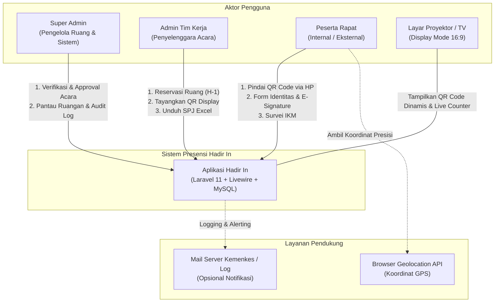
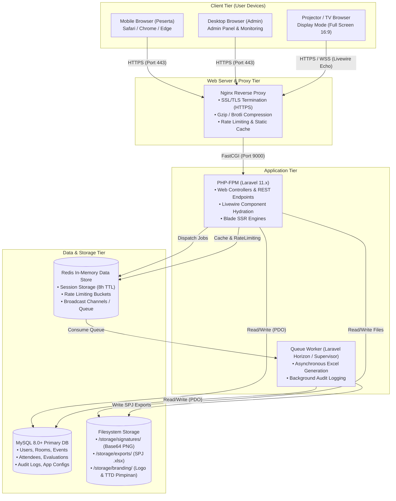
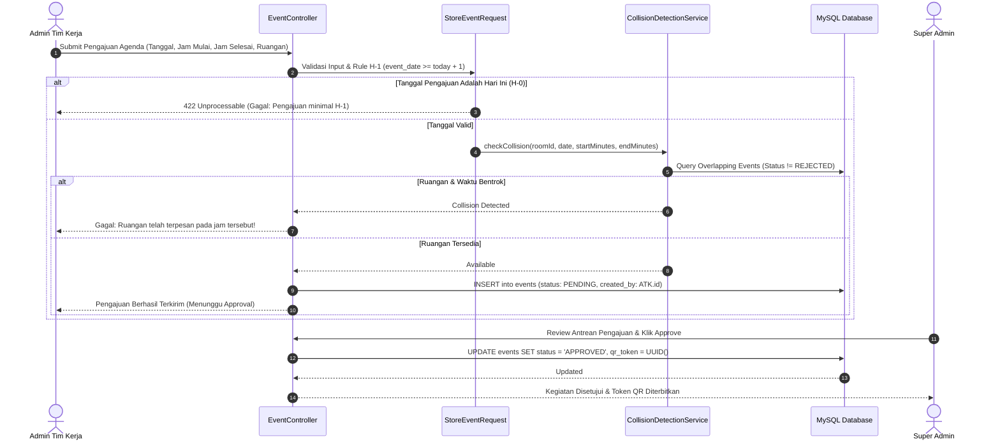
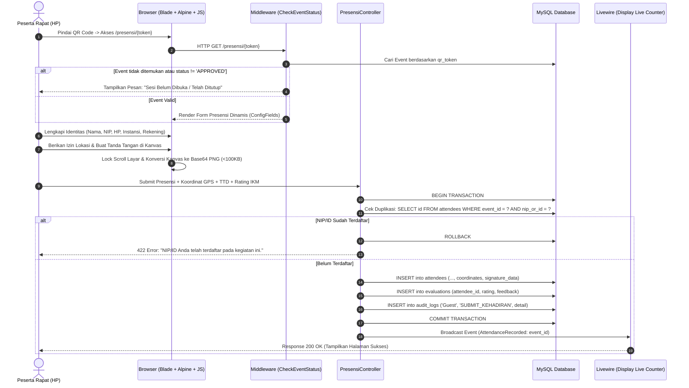
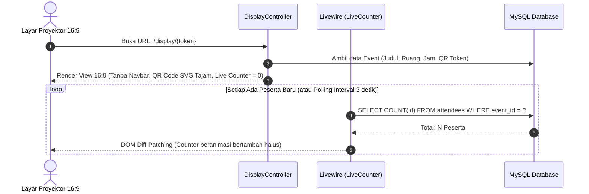

# System Architecture & Project Structure Document
## Sistem Daftar Hadir Online Berbasis QR Code & E-Signature — "Hadir In"

* **Target Institusi:** Balai Besar Kekarantinaan Kesehatan (BBKK) Tanjung Priok, Kementerian Kesehatan RI
* **Referensi Utama:** [Hadirin.md (PRD v1.0)](file:///d:/Hadir%20In/Hadirin.md), [TechStack.md (Tech Stack v2.0)](file:///d:/Hadir%20In/TechStack.md) & [CodingGuidelines.md](file:///d:/Hadir%20In/CodingGuidelines.md)
* **Versi Dokumen:** 1.0.0
* **Tanggal:** 13 Oktober 2026
* **Status:** Arsitektur Disetujui (Approved for Implementation)

---

## 1. Prinsip & Pola Desain Arsitektur

Sistem dirancang menggunakan arsitektur **Layered Monolith with Reactive Components & Service-Oriented Domain Layer**. Pendekatan ini dipilih untuk memaksimalkan kecepatan rilis (4 minggu), kemudahan *deployment* pada infrastruktur instansi pemerintah, keandalan integritas data ACID, serta biaya operasional yang hemat.

```text
┌────────────────────────────────────────────────────────────────────────┐
│                        PRESENTATION LAYER                              │
│  Blade Templates  │  Tailwind CSS 3.x  │  Livewire 3.x  │  Alpine.js   │
│  Signature Pad JS │  Geolocation API   │  Display Mode 16:9 View       │
└───────────────────────────────────┬────────────────────────────────────┘
                                    │ HTTP / WebSocket / AJAX
                                    ▼
┌────────────────────────────────────────────────────────────────────────┐
│                        APPLICATION & ROUTING LAYER                     │
│  Web Routes       │  Middleware Pipeline (Auth, RBAC, EventStatus, Log)│
│  Controllers (Super Admin, Tim Kerja, Display, Presensi, Auth)         │
│  Form Requests (Validation & Sanitization)                             │
└───────────────────────────────────┬────────────────────────────────────┘
                                    │ DTO / Filtered Input
                                    ▼
┌────────────────────────────────────────────────────────────────────────┐
│                        DOMAIN & SERVICE LAYER                          │
│  CollisionDetectionService │  QrTokenService    │  ExcelExportService  │
│  AuditLogService           │  AppConfigService  │  PresensiAction      │
└───────────────────────────────────┬────────────────────────────────────┘
                                    │ Eloquent Queries & Transactions
                                    ▼
┌────────────────────────────────────────────────────────────────────────┐
│                        INFRASTRUCTURE & PERSISTENCE                    │
│  Eloquent ORM Models & Enums           │  MySQL 8.0+ (ACID Relational) │
│  Redis (Cache, Session, Queue Worker) │  Storage Disk (Local / S3)    │
└────────────────────────────────────────────────────────────────────────┘
```

### 1.1 Prinsip Desain Kunci
1. **Single Source of Truth (Database Constraint Integrity):**
   * Validasi tidak hanya berhenti di *frontend* atau *controller*, melainkan dikunci hingga ke level *database schema* (`UNIQUE(event_id, nip_or_id)`, `UNIQUE(qr_token)`, *Foreign Key Cascades*).
2. **Fail-Safe & Self-Healing Operations:**
   * Penanganan *edge case* (rotasi gawai saat tanda tangan, koneksi seluler lambat, upaya submit ganda) diselesaikan secara otomatis tanpa membuat data korup.
3. **Audit Trail Immutability:**
   * Setiap aktivitas perubahan data, login gagal, dan pengisian presensi dicatat dalam tabel `audit_logs` yang bersifat *append-only* (tidak dapat diubah/dihapus oleh aplikasi normal).
4. **Separation of Concerns:**
   * Logika bisnis kompleks (misal deteksi bentrok jadwal ruangan dan pembuatan file Excel) diisolasi ke dalam *Dedicated Services*, bukan menumpuk di dalam *Controller* atau *Blade View*.

---

## 2. Diagram Arsitektur C4 (Sistem Konteks & Kontainer)

### 2.1 C4 Level 1: System Context



### 2.2 C4 Level 2: Container Diagram (Arsitektur Teknis)



---

## 3. Alur Kerja Kritis & Diagram Sekuensial (Sequence Flows)

### 3.1 Alur 1: Pengajuan Agenda & Deteksi Bentrok Ruangan (FR-01, FR-02)



### 3.2 Alur 2: Presensi Mandiri, Validasi GPS, dan E-Signature (FR-07 s/d FR-11)



### 3.3 Alur 3: Display Mode Proyektor & Live Counter Real-Time (FR-05, FR-06)



---

## 4. Struktur Direktori Proyek Laravel 11 (Lengkap & Terorganisir)

Berikut adalah struktur direktori lengkap dari project `hadir-in`, mencakup semua komponen bisnis yang dibutuhkan:

```text
hadir-in/
├── app/
│   ├── Actions/                                # Single-Action Domain Invokers
│   │   ├── Presensi/
│   │   │   └── RecordAttendanceAction.php      # Atomic transaction simpan peserta + IKM + log
│   │   └── Events/
│   │       ├── ApproveEventAction.php          # Approval event + generate QR token
│   │       └── RejectEventAction.php           # Reject event + catatan penolakan
│   │
│   ├── Console/
│   │   └── Commands/
│   │       ├── ResetAdminCommand.php           # Rescue CLI: reset akun admin & unlock cache
│   │       └── PurgeOldSignaturesCommand.php   # Pemeliharaan disk: arsip TTD acara lampau
│   │
│   ├── Enums/                                  # Pure PHP 8.3 Enums
│   │   ├── EventStatus.php                     # PENDING, APPROVED, REJECTED, CLOSED
│   │   ├── Gender.php                          # LAKI_LAKI, PEREMPUAN
│   │   ├── IkmRating.php                       # SANGAT_BAIK, BAIK, CUKUP, KURANG
│   │   └── UserRole.php                        # SUPER_ADMIN, ADMIN_TIM_KERJA
│   │
│   ├── Exports/                                # Maatwebsite Laravel Excel Classes
│   │   ├── SpjAttendanceExport.php             # Export format SPJ resmi BBKK Tanjung Priok
│   │   └── Sheets/
│   │       ├── AttendanceDataSheet.php         # Lembar data tabel peserta & rekening
│   │       └── IkmSummarySheet.php             # Lembar rekapitulasi rating kepuasan
│   │
│   ├── Http/
│   │   ├── Controllers/
│   │   │   ├── Auth/
│   │   │   │   ├── AuthenticatedSessionController.php # Login / Logout
│   │   │   │   └── ConfirmablePasswordController.php
│   │   │   ├── SuperAdmin/
│   │   │   │   ├── DashboardController.php     # Dasbor analitik global & ruang rapat
│   │   │   │   ├── EventApprovalController.php # Antrean & approval permohonan kegiatan
│   │   │   │   ├── RoomManagementController.php# CRUD data master ruang rapat
│   │   │   │   ├── AppConfigController.php     # Pengaturan Profil & TTD Pimpinan
│   │   │   │   ├── AuditLogController.php      # Penelusuran jejak audit sistem
│   │   │   │   └── GlobalReportController.php  # Laporan lintas seksi / tim kerja
│   │   │   ├── AdminTimKerja/
│   │   │   │   ├── EventController.php         # Pengajuan & CRUD kegiatan tim kerja
│   │   │   │   ├── AttendeeMonitorController.php# Tabel peserta langsung per acara
│   │   │   │   └── ExportReportController.php  # Download Excel SPJ per kegiatan
│   │   │   ├── DisplayController.php           # Controller publik /display/{token}
│   │   │   └── PresensiController.php          # Controller publik /presensi/{token}
│   │   │
│   │   ├── Middleware/
│   │   │   ├── CheckRole.php                   # Otorisasi role: SUPER_ADMIN / ADMIN_TIM_KERJA
│   │   │   ├── CheckEventStatus.php            # Validasi ketersediaan sesi presensi
│   │   │   └── AuditRequestLogger.php          # Middleware logging aktivitas ke audit_logs
│   │   │
│   │   └── Requests/                           # Form Requests (Validasi Deklaratif)
│   │       ├── StoreEventRequest.php           # Validasi jadwal H-1 & input agenda
│   │       ├── UpdateEventRequest.php
│   │       ├── RejectEventRequest.php          # Validasi wajib isi alasan penolakan (FR-04)
│   │       ├── StoreAttendeeRequest.php        # Validasi NIP 18 digit, nomor HP, dsb.
│   │       └── UpdatePimpinanConfigRequest.php # Validasi profil pimpinan & TTD base64
│   │
│   ├── Livewire/                               # Komponen Reaktif Real-Time
│   │   ├── Display/
│   │   │   └── LiveCounter.php                 # Live counter kehadiran proyektor 16:9
│   │   ├── Admin/
│   │   │   ├── EventStatusToggle.php           # Toggle cepat Buka/Tutup agenda
│   │   │   ├── RoomCalendarView.php            # Visualisasi jadwal ruang rapat
│   │   │   └── LiveAttendeeTable.php           # Tabel kehadiran auto-refresh
│   │
│   ├── Models/                                 # Eloquent ORM Models
│   │   ├── User.php
│   │   ├── Room.php
│   │   ├── Event.php
│   │   ├── Attendee.php
│   │   ├── Evaluation.php
│   │   ├── AuditLog.php
│   │   └── AppConfig.php
│   │
│   ├── Providers/
│   │   ├── AppServiceProvider.php
│   │   ├── AuthServiceProvider.php
│   │   └── EventServiceProvider.php
│   │
│   └── Services/                               # Core Domain Services
│       ├── CollisionDetectionService.php       # Algoritma pendeteksi bentrok jadwal
│       ├── QrTokenService.php                  # Penerbit token unik & enkoder QR SVG
│       ├── ExcelExportService.php              # Formatting layout SPJ, border, kop dinas
│       ├── AuditLogService.php                 # Logger tersentralisasi (User & Guest)
│       └── AppConfigService.php                # Cache-aware config reader & writer
│
├── database/
│   ├── factories/
│   │   ├── EventFactory.php
│   │   └── AttendeeFactory.php
│   ├── migrations/                             # Skema Database MySQL (7 Tabel)
│   │   ├── 2026_01_01_000001_create_users_table.php
│   │   ├── 2026_01_01_000002_create_rooms_table.php
│   │   ├── 2026_01_01_000003_create_events_table.php
│   │   ├── 2026_01_01_000004_create_attendees_table.php
│   │   ├── 2026_01_01_000005_create_evaluations_table.php
│   │   ├── 2026_01_01_000006_create_audit_logs_table.php
│   │   └── 2026_01_01_000007_create_app_configs_table.php
│   └── seeders/
│       ├── DatabaseSeeder.php
│       ├── UserSeeder.php                      # Default admin_bbkk & super admin
│       ├── RoomSeeder.php                      # Master ruangan BBKK Tanjung Priok
│       └── AppConfigSeeder.php                 # Inisialisasi key INFO_PIMPINAN
│
├── resources/
│   ├── css/
│   │   └── app.css                             # Tailwind directives & custom utilities
│   ├── js/
│   │   ├── app.js                              # Bootstrap Alpine & Livewire
│   │   ├── components/
│   │   │   ├── signature-pad.js                # Canvas E-sign, touch lock, resize observer
│   │   │   └── geolocation.js                  # Browser GPS Geolocation helper
│   │   └── echo.js                             # Konfigurasi WebSocket / Livewire Polling
│   │
│   └── views/
│       ├── layouts/
│       │   ├── admin.blade.php                 # Layout panel admin (sidebar, topbar)
│       │   ├── guest.blade.php                 # Layout bersih untuk login
│       │   ├── display.blade.php               # Layout monitor 16:9 tanpa navbar
│       │   └── mobile-presensi.blade.php       # Layout mobile-first untuk peserta
│       │
│       ├── components/                         # Blade Components Reusable
│       │   ├── alert.blade.php
│       │   ├── button.blade.php
│       │   ├── input.blade.php
│       │   └── modal.blade.php
│       │
│       ├── auth/
│       │   └── login.blade.php                 # Form login aman dengan rate limit notice
│       │
│       ├── super-admin/
│       │   ├── dashboard.blade.php
│       │   ├── approvals/index.blade.php       # Antrean verifikasi permohonan
│       │   ├── rooms/index.blade.php
│       │   ├── config/pimpinan.blade.php       # Upload TTD & Biodata Pimpinan
│       │   └── audit-logs/index.blade.php      # Tabel jejak audit sistem
│       │
│       ├── admin-tim-kerja/
│       │   ├── events/
│       │   │   ├── index.blade.php             # Riwayat kegiatan tim kerja
│       │   │   ├── create.blade.php            # Form pengajuan rapat (H-1)
│       │   │   └── show.blade.php              # Detail acara & link display
│       │   └── attendees/
│       │       └── monitor.blade.php           # Pemantauan peserta & tombol SPJ
│       │
│       ├── display/
│       │   └── show.blade.php                  # Layar Monitor QR Code 16:9 (FR-05)
│       │
│       └── presensi/
│           ├── form.blade.php                  # Form Presensi Mobile (FR-08, FR-09)
│           ├── signature-canvas.blade.php      # Kanvas E-Signature Anti-Offset (FR-11)
│           ├── ikm-survey.blade.php            # Survei Kepuasan 4 Skala (FR-12)
│           ├── success.blade.php               # Halaman Sukses & Bukti Presensi
│           └── closed.blade.php                # Halaman Informasi Sesi Belum/Ditutup
│
├── routes/
│   ├── web.php                                 # Semua web routes terstruktur
│   ├── console.php                             # Artisan commands routes
│   └── channels.php                            # Broadcast authorization channels
│
├── storage/
│   ├── app/
│   │   └── public/
│   │       ├── signatures/                     # File tanda tangan peserta (.png)
│   │       ├── branding/                       # Logo Kemenkes & TTD Pimpinan
│   │       └── exports/                        # File cache SPJ Excel
│   └── logs/
│       └── laravel.log
│
├── tests/
│   ├── Feature/
│   │   ├── CollisionDetectionTest.php          # Uji pencegahan jadwal bentrok
│   │   ├── AttendanceSubmissionTest.php        # Uji pengisian form & anti-duplikasi
│   │   ├── EventApprovalWorkflowTest.php       # Uji siklus approval Super Admin
│   │   └── SpjExcelExportTest.php              # Uji kebenaran struktur file Excel
│   └── Unit/
│       ├── QrTokenServiceTest.php
│       └── CollisionDetectionServiceTest.php
│
├── .env.example
├── composer.json
├── package.json
├── tailwind.config.js
└── vite.config.js
```

---

## 5. Rincian Skema Database MySQL (Data Definition Language)

### 5.1 Tabel `users`
Menyimpan akun pengguna sistem internal (Super Admin dan Admin Tim Kerja).

```sql
CREATE TABLE `users` (
  `id` CHAR(36) NOT NULL,
  `username` VARCHAR(50) NOT NULL UNIQUE,
  `password` VARCHAR(255) NOT NULL,
  `name` VARCHAR(100) NOT NULL,
  `role` ENUM('SUPER_ADMIN', 'ADMIN_TIM_KERJA') NOT NULL DEFAULT 'ADMIN_TIM_KERJA',
  `work_unit` VARCHAR(100) NULL,
  `remember_token` VARCHAR(100) NULL,
  `created_at` TIMESTAMP NULL DEFAULT CURRENT_TIMESTAMP,
  `updated_at` TIMESTAMP NULL DEFAULT CURRENT_TIMESTAMP ON UPDATE CURRENT_TIMESTAMP,
  PRIMARY KEY (`id`)
) ENGINE=InnoDB DEFAULT CHARSET=utf8mb4 COLLATE=utf8mb4_unicode_ci;
```

### 5.2 Tabel `rooms`
Menyimpan daftar ruang rapat kedinasan di lingkungan institusi.

```sql
CREATE TABLE `rooms` (
  `id` CHAR(36) NOT NULL,
  `name` VARCHAR(100) NOT NULL UNIQUE,
  `capacity` INT NULL,
  `location_detail` VARCHAR(255) NULL,
  `is_active` BOOLEAN NOT NULL DEFAULT TRUE,
  `created_at` TIMESTAMP NULL DEFAULT CURRENT_TIMESTAMP,
  `updated_at` TIMESTAMP NULL DEFAULT CURRENT_TIMESTAMP ON UPDATE CURRENT_TIMESTAMP,
  PRIMARY KEY (`id`)
) ENGINE=InnoDB DEFAULT CHARSET=utf8mb4 COLLATE=utf8mb4_unicode_ci;
```

### 5.3 Tabel `events`
Menyimpan data agenda rapat, status perizinan ruangan, dan token QR dinamis.

```sql
CREATE TABLE `events` (
  `id` CHAR(36) NOT NULL,
  `title` VARCHAR(255) NOT NULL,
  `room_id` CHAR(36) NOT NULL,
  `event_date` DATE NOT NULL,
  `start_minutes` INT NOT NULL COMMENT 'Menit dari 00:00, cth: 08:30 = 510',
  `end_minutes` INT NOT NULL COMMENT 'Menit dari 00:00, cth: 11:30 = 690',
  `work_unit` VARCHAR(100) NOT NULL,
  `status` ENUM('PENDING', 'APPROVED', 'REJECTED', 'CLOSED') NOT NULL DEFAULT 'PENDING',
  `rejection_note` TEXT NULL,
  `qr_token` CHAR(36) NOT NULL UNIQUE,
  `config_fields` JSON NULL COMMENT 'Konfigurasi field aktif: [nip, jabatan, gender, hp, instansi, alamat, rekening]',
  `created_by` CHAR(36) NOT NULL,
  `created_at` TIMESTAMP NULL DEFAULT CURRENT_TIMESTAMP,
  `updated_at` TIMESTAMP NULL DEFAULT CURRENT_TIMESTAMP ON UPDATE CURRENT_TIMESTAMP,
  PRIMARY KEY (`id`),
  CONSTRAINT `fk_events_room` FOREIGN KEY (`room_id`) REFERENCES `rooms` (`id`) ON DELETE RESTRICT,
  CONSTRAINT `fk_events_user` FOREIGN KEY (`created_by`) REFERENCES `users` (`id`) ON DELETE RESTRICT,
  INDEX `idx_events_collision` (`room_id`, `event_date`, `start_minutes`, `end_minutes`, `status`)
) ENGINE=InnoDB DEFAULT CHARSET=utf8mb4 COLLATE=utf8mb4_unicode_ci;
```

### 5.4 Tabel `attendees`
Menyimpan data presensi mandiri peserta, termasuk E-Signature, koordinat GPS, dan rekening transport.

```sql
CREATE TABLE `attendees` (
  `id` CHAR(36) NOT NULL,
  `event_id` CHAR(36) NOT NULL,
  `full_name` VARCHAR(150) NOT NULL,
  `agency` VARCHAR(150) NOT NULL,
  `is_internal` BOOLEAN NOT NULL DEFAULT TRUE,
  `gender` ENUM('LAKI_LAKI', 'PEREMPUAN') NOT NULL,
  `nip_or_id` VARCHAR(30) NOT NULL,
  `position` VARCHAR(100) NOT NULL,
  `phone` VARCHAR(25) NULL,
  `address` VARCHAR(255) NULL,
  `bank_name` VARCHAR(50) NULL,
  `bank_account_no` VARCHAR(35) NULL,
  `bank_account_name` VARCHAR(100) NULL,
  `coordinates` VARCHAR(100) NULL COMMENT 'GPS Latitude,Longitude',
  `signature_data` MEDIUMTEXT NOT NULL COMMENT 'Base64 Encoded PNG Image',
  `created_at` TIMESTAMP NULL DEFAULT CURRENT_TIMESTAMP,
  PRIMARY KEY (`id`),
  CONSTRAINT `fk_attendees_event` FOREIGN KEY (`event_id`) REFERENCES `events` (`id`) ON DELETE CASCADE,
  CONSTRAINT `uk_attendees_event_nip` UNIQUE (`event_id`, `nip_or_id`),
  INDEX `idx_attendees_event` (`event_id`)
) ENGINE=InnoDB DEFAULT CHARSET=utf8mb4 COLLATE=utf8mb4_unicode_ci;
```

### 5.5 Tabel `evaluations`
Menyimpan survei evaluasi Indeks Kepuasan Masyarakat (IKM) dari peserta.

```sql
CREATE TABLE `evaluations` (
  `id` CHAR(36) NOT NULL,
  `attendee_id` CHAR(36) NOT NULL UNIQUE,
  `rating` ENUM('SANGAT_BAIK', 'BAIK', 'CUKUP', 'KURANG') NOT NULL,
  `feedback` TEXT NULL,
  `created_at` TIMESTAMP NULL DEFAULT CURRENT_TIMESTAMP,
  PRIMARY KEY (`id`),
  CONSTRAINT `fk_evaluations_attendee` FOREIGN KEY (`attendee_id`) REFERENCES `attendees` (`id`) ON DELETE CASCADE
) ENGINE=InnoDB DEFAULT CHARSET=utf8mb4 COLLATE=utf8mb4_unicode_ci;
```

### 5.6 Tabel `audit_logs`
Menyimpan rekam jejak aktivitas operasional (*audit trail*).

```sql
CREATE TABLE `audit_logs` (
  `id` BIGINT UNSIGNED NOT NULL AUTO_INCREMENT,
  `timestamp` TIMESTAMP NOT NULL DEFAULT CURRENT_TIMESTAMP,
  `username` VARCHAR(50) NOT NULL COMMENT 'Username atau Guest',
  `action` VARCHAR(50) NOT NULL COMMENT 'LOGIN, ADD_KEGIATAN, SUBMIT_KEHADIRAN, etc.',
  `detail` TEXT NOT NULL,
  `ip_address` VARCHAR(45) NULL,
  `user_agent` VARCHAR(255) NULL,
  PRIMARY KEY (`id`),
  INDEX `idx_audit_logs_timestamp` (`timestamp`),
  INDEX `idx_audit_logs_action` (`action`)
) ENGINE=InnoDB DEFAULT CHARSET=utf8mb4 COLLATE=utf8mb4_unicode_ci;
```

### 5.7 Tabel `app_configs`
Menyimpan parameter aplikasi, profil pimpinan kedinasan, dan tanda tangan resmi pengesah.

```sql
CREATE TABLE `app_configs` (
  `id` INT UNSIGNED NOT NULL AUTO_INCREMENT,
  `config_key` VARCHAR(50) NOT NULL UNIQUE,
  `config_value` JSON NOT NULL,
  `updated_at` TIMESTAMP NULL DEFAULT CURRENT_TIMESTAMP ON UPDATE CURRENT_TIMESTAMP,
  PRIMARY KEY (`id`)
) ENGINE=InnoDB DEFAULT CHARSET=utf8mb4 COLLATE=utf8mb4_unicode_ci;
```

---

## 6. Arsitektur Keamanan & Mitigasi Risiko

| Kategori Risiko | Potensi Ancaman | Strategi Penanganan Sistem |
| :--- | :--- | :--- |
| **Brute Force Login** | Serangan tebak sandi akun administrator. | Menerapkan `RateLimiter::for('login')` dengan batas 5 kegagalan dan penahanan akses 15 menit, disertai pencatatan ke `audit_logs`. |
| **Duplikasi Presensi** | Peserta mengirimkan formulir dua kali untuk memanipulasi kehadiran atau SPJ transport. | Proteksi dua lapis: Pengecekan di level aplikasi (`firstOrFail`) dan penegakan kunci integritas fisik `UNIQUE(event_id, nip_or_id)` di MySQL. |
| **Manipulasi Jam Ruang (Race Condition)** | Dua Admin Tim Kerja mengajukan ruangan dan jam yang sama pada detik yang bersamaan. | Menggunakan MySQL InnoDB Transaction dengan isolasi `SELECT ... FOR UPDATE` atau Redis Atomic Lock (`Cache::lock()`) saat pemesanan diproses. |
| **Payload E-Sign Berlebih** | Pengiriman gambar tanda tangan berukuran megabyte yang melumpuhkan server. | Validasi ukuran payload Base64 di *client-side* (kompresi kanvas ke resolusi ideal) dan validasi di Laravel Form Request (`max:100kb`). |
| **Cross-Site Scripting (XSS)** | Injeksi skrip berbahaya lewat input Nama, NIP, atau Instansi. | Sanitasi input otomatis menggunakan `htmlspecialchars` bawaan Blade `{{ }}`, serta pembersihan tag HTML via middleware. |
| **Kehilangan Kredensial Admin** | Admin terkunci atau lupa kata sandi di server lokal. | Perintah CLI darurat bawaan: `php artisan admin:reset` yang langsung memperbarui password admin tanpa membuka basis data manual. |

---

## 7. Arsitektur Deployment & Konfigurasi Server Produksi

```text
                               Internet
                                  │
                                  ▼
                         [ Port 80 / 443 ]
                     ┌───────────────────────┐
                     │   Nginx Web Server    │
                     │  (SSL via Certbot)    │
                     └───────────┬───────────┘
                                 │
             ┌───────────────────┴───────────────────┐
             │ FastCGI (Unix Socket)                 │
             ▼                                       ▼
 ┌───────────────────────┐               ┌───────────────────────┐
 │    PHP 8.3 PHP-FPM    │               │  Static Assets Cache  │
 │  (Laravel App Worker) │               │  (/public/build/...)  │
 └───────────┬───────────┘               └───────────────────────┘
             │
     ┌───────┴───────┐
     ▼               ▼
┌─────────┐     ┌─────────┐
│  MySQL  │     │  Redis  │
│  8.0+   │     │  7.x    │
└─────────┘     └─────────┘
     ▲               ▲
     │               │
┌────┴───────────────┴────┐
│    Supervisor Worker    │
│ (php artisan queue:work)│
└─────────────────────────┘
```

### 7.1 Spesifikasi Server Produksi
* **Operating System:** Ubuntu 24.04 LTS (x64)
* **Processor / RAM:** Minimal 2 vCPU / 4 GB RAM (Mendukung 500+ pengguna serentak)
* **Storage:** 40 GB NVMe SSD (Penyimpanan citra E-Signature teroptimasi)
* **Background Worker:** `systemd` / `supervisor` untuk menjaga `queue:work` tetap berjalan.
* **Database Backup:** Cron job harian otomatis via `mysqldump` dengan rotasi retensi 30 hari.

---

> [!TIP]
> Dokumen ini dirancang sebagai panduan implementasi teknis menyeluruh bagi tim pengembang. Struktur folder dan skema di atas dapat langsung diaplikasikan ke dalam pembuatan proyek baru Laravel 11.
